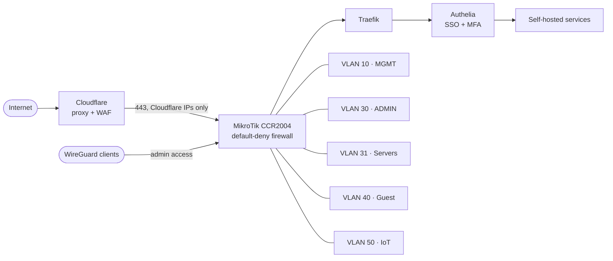

# Hi, I'm Ruben 👋

**Network Engineer · NetOps** at **Orbius** (formerly MTNSat / Anuvu) — maritime and satellite networks, Cantabria, Spain.

I design, deploy and troubleshoot enterprise networks for vessels and remote sites: VSAT and LEO (Starlink, OneWeb), SD-WAN, multi-vendor routing and firewalls. I also act as Tier-3 escalation for the NOC.

At home I run a small production-style lab where I test the same ideas end to end.

## 🏠 Home lab

**Repo:** [rubenih/homelab](https://github.com/rubenih/homelab) — architecture, configuration and documentation as code.

- **Network:** MikroTik CCR2004 + Cisco SG200, five segmented VLANs, default-deny forward and output chains.
- **Remote access:** WireGuard for administration; selected services published through Cloudflare proxy, WAF rules and Authelia (SSO + MFA). The router only accepts HTTPS from Cloudflare IP ranges.
- **Compute:** Proxmox VE + Proxmox Backup Server, Docker Compose service stack.
- **Monitoring:** Zabbix 7 + Grafana (SNMP, agents, UPS via NUT).
- **Documentation as code:** lab inventory in [RackPeek](https://github.com/Timmoth/RackPeek) YAML, published as a [read-only viewer on GitHub Pages](https://rubenih.github.io/homelab/).

## 🧰 Tech stack

| Area | Tools |
|---|---|
| Networking & security | Cisco, MikroTik RouterOS, Palo Alto Networks, Peplink, pfSense, WireGuard, Tailscale |
| Protocols | TCP/IP, NAT, DHCP, DNS, SD-WAN, QoS, HSRP, VRRP, ECMP |
| Satellite & WAN | iDirect, Newtec, SES FLEX, SCPC/TDMA, Starlink, OneWeb |
| Virtualization & containers | VMware ESXi, Proxmox VE, Docker, Docker Compose |
| Monitoring & docs | Zabbix, Grafana, SolarWinds Orion, RackPeek, Visio, Confluence |

## 📫 Contact

[LinkedIn](https://linkedin.com/in/rubenih) · [rubenisahidalgo@gmail.com](mailto:rubenisahidalgo@gmail.com)
